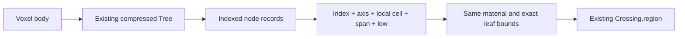

The compressed tree can be stored as indexed records, but the installed Bend 2.0.34 runtime has an ownership constraint: **native `Array` storage is contiguous and affine; it has no safe immutable sharing API that preserves today’s reusable `Grid` interface.**

The most direct representation is an affine array of nonrecursive `Data` records: `Leaf{material: U32}` or `Branch{left: U32, right: U32}`. Flatten the existing compressed tree after construction, then change lookup to follow child indices while retaining the current spatial descent.

The relevant findings are:

- **Preserve topology during packing.** `Tree.join` merges only equal solid children. Cuboid construction preserves paint precedence through `List.reverse`; dense construction samples the row-major snapshot and builds the cyclic spatial tree. Pack that resulting tree without changing its splits or compression. Flattening `V.Snapshot` directly would preserve a different hierarchy and would not establish identical leaf bounds. See [construction](/home/aivv/Документы/projects/bend-voxel-main/dda.bend:77), [Grid.build](/home/aivv/Документы/projects/bend-voxel-main/dda.bend:142), and [Snapshot.read](/home/aivv/Документы/projects/bend-voxel-main/voxel.bend:187).

- **Bounds require the same descent, not additional stored coordinates.** `Tree.read` and `Tree.region` cycle X → Y → Z, halve the selected span, and subtract the half-span from the local coordinate on right descent. `Tree.region` also advances the absolute lower corner. At a leaf, it returns `high = low + span`. Indexed traversal can reproduce those operations exactly. Outside reads must remain `0`; outside regions must remain the complete zero sentinel. See [lookup](/home/aivv/Документы/projects/bend-voxel-main/dda.bend:151) and [region lookup](/home/aivv/Документы/projects/bend-voxel-main/dda.bend:182).

- **Native Array is not a pointer tree.** Installed Base declares `Array<T>` as affine `Type`, with `ALeaf`/`ANode` semantics. Retained native C instead represents it as a contiguous block: `BUF` contains 32-bit words, while `ARR` contains 64-bit terms. Matching `ANode` allocates and copies halves; constructing it combines blocks. Use `Array.get`/`set` for indexed access, rather than manually matching array constructors in the hot traversal. See [installed declaration](/home/aivv/.bend/bend2/base.bend:70) and [emitted block implementation](/home/aivv/Документы/projects/bend-voxel-main/.audit/dda-boundary/candidate.c:1719).

- **Scalar records can stay flat.** The adjacent compiler checkout also identifies itself as 2.0.34; its Array definitions match installed Base. Its emitter selects `BUF` when every element field has a 32-bit layout and rounds record stride to a power of two. The suggested leaf/branch record therefore has a predicted four-word stride, including its tag and padding. `Array.get` loads scalar fields directly and returns the unchanged array alongside the record. Boxed fields instead invoke `blk_keep`. Confirm the precise layout in the parent’s next emission. See [layout selection](/home/aivv/Документы/projects/bend/bend2/comp.ts:1072) and [array lowering](/home/aivv/Документы/projects/bend/bend2/comp.ts:1830).

- **`Data` elements do not make their array reusable.** An array-backed `Grid` must become `Type`. Lookup should return `Grid & U32` or `Grid & Region`; tracing should return the grid with its hit result. A wrapper that returns only the lookup result drops the array owner. The compiler explicitly excludes Array parameters from ordinary borrowing. See [installed get contract](/home/aivv/.bend/bend2/base.bend:2400) and [borrow analysis](/home/aivv/Документы/projects/bend/bend2/comp.ts:1266).

The viable choices have different constraints:

| Storage choice | Read and ownership model | Assessment |
|---|---|---|
| `Array<IndexedNode>` or explicit `Array<U32>` records | Thread one affine owner through lookup, rays, and sequential frame work | Best starting point for contiguous storage and safe proofs. |
| Native arrays cloned for parallel readers | Give each reader an independent owner using `Array.clone`; return owners with results | Safe Bend option, but cloning entire tables may cost substantial memory and frame time. |
| Indexed records in a persistent `Data` tree or paged structure | Reusable storage with scalar index cursors and borrowed reads | Preserves reusable interfaces, but adds storage lookup work and is not a native contiguous array. |
| Shared native handles using `Array.fork` | Multiple handles access the same block | Runtime-supported, but incompatible with the current proof gate. |
| A dedicated immutable native-array API | Freeze ownership, share reads, expose no writes | Absent from this installation; requires compiler/runtime work beyond an engine-only change. |

`Array.fork` and `Array.join` are explicitly `@unsafe` in [installed Base](/home/aivv/.bend/bend2/base.bend:2301). I checked the existing fork example with the installed binary using `--check-only`; it returned `SOME PROOFS FAIL` and flagged eight dependent definitions. The [dependency audit](/home/aivv/Документы/projects/bend/bend2/main.ts:737) propagates unsafe dependencies from Base, and the [kernel translator](/home/aivv/Документы/projects/bend/bend2/safe.ts:288) also rejects them.

Ownership deserves particular attention. Current emitted `Tree.region` descends using `term_peek`, without retaining or dropping each branch, although shared redirects still require atomic loads. The rejected cursor experiment introduced consuming prefix matches through `ctr_take`, which can retain fields and drop discarded siblings. Replacing subtree cursors with scalar indices avoids owning cached subtrees, but does not itself solve array sharing. See [current borrowed descent](/home/aivv/Документы/projects/bend-voxel-main/.audit/dda-boundary/candidate.c:6294), [consuming cursor descent](/home/aivv/Документы/projects/bend-voxel-main/.audit/dda-cursor/candidate2.c:6495), and [cursor findings](/home/aivv/Документы/projects/bend-voxel-main/docs/dda-cursor.md:15).

An affine implementation affects the whole lookup path through `Trace`, `Frame.seq`, `Frame.fork`, and `Frame.image`. It also changes `Scene is Data`, `Scene.draw(+scene)`, and both comparison scans, which currently reuse the grid. See [frame interfaces](/home/aivv/Документы/projects/bend-voxel-main/dda.bend:436), [scene ownership](/home/aivv/Документы/projects/bend-voxel-main/scripts/dda_compare.bend:10), and [comparison scans](/home/aivv/Документы/projects/bend-voxel-main/scripts/dda_compare.bend:154).

I recommend first packing the unchanged compressed tree into scalar indexed records and implementing owner-threaded lookup. Keep these constraints explicit:

- Prove **full `Region` equality**, including material, low, high, and outside sentinel. The existing [region law](/home/aivv/Документы/projects/bend-voxel-main/LAWS.bend:232) proves material equality only.
- Establish valid child indices, sufficient capacity despite Array’s wrapping indices, acyclicity, and terminating lookup fuel. Index descent no longer supplies a structurally smaller `Tree`.
- Preserve every U32 material unless a formal restriction justifies tag-bit packing.
- Keep the accepted [direct conversion](/home/aivv/Документы/projects/bend-voxel-main/dda.bend:287) and [guarded boundary-count reuse](/home/aivv/Документы/projects/bend-voxel-main/dda.bend:300).
- Validate against the frozen tree and baseline images. `--verify-steps` alone cannot detect a storage bug shared by both traversal modes.
- Express engine logic in Bend; the native block implementation already supports CPU, CUDA, and Metal through the same source. Backend-specific pointers or read intrinsics are unnecessary.

No files were written, and no compilation or benchmarks were run. The parent still needs to verify the candidate’s emitted layout, prove representation equivalence, and measure complete frames before selecting its parallel ownership strategy.
