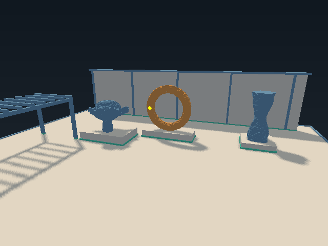

# Vulkan renderer for bend-voxel

Use the [library setup](../deps/bend-vulkan/README.md#build-your-first-example), then install X11 development headers and `libX11.so.6`.
The demo requires an X11 display, sampled D32 depth images, and the [presentation extensions](docs/presentation.md#api-profile), including `VK_EXT_swapchain_maintenance1`.

From the bend-voxel repository root, initialize the pinned Vulkan dependency, then enter the renderer directory:

```sh
git submodule update --init --recursive deps/bend-vulkan
cd vulkan
mkdir -p build
bend examples/voxel_interactive.bend -o build/voxel-interactive
./build/voxel-interactive
```

| Input | Action |
| --- | --- |
| WASD, Q/E | Move the camera |
| Hold right mouse button | Look around |
| Left click or Space | Carve the hovered surface with a 20 cm brush |
| R | Restore the scene while keeping the camera |
| Escape or window close | Exit |

Resize and minimize preserve the world state. Normal runs are quiet; add `--trace` for diagnostics.
Use `--cube` for the basic cube demo, where Space applies the fixed demo cut.

The default is `--slots=2`; `--slots=1` uses one frame slot. Set Bend's CPU worker count separately with runtime options:

```sh
./build/voxel-interactive +RTS --threads 4 -RTS --slots=2
```

See the [presentation contract](docs/presentation.md) for input, frame ownership, and completion behavior.

## Ownership and checks

`src/` contains voxel meshing, scene, camera, appearance, residency and frame policy.
`examples/` contains the Atelier and cube entry points. `tests/`, `shaders/`,
`LAWS.bend`, `PROOF.bend` and `tools/` belong to this consumer.
The renderer imports voxel geometry, materials and reference rendering from the
parent repository. Its Vulkan API, math implementation and shared example helpers
come from `../deps/bend-vulkan/`. The dependency runs only toward bend-vulkan.
The existing Bend-native renderer and root laws remain independent of Vulkan.

From `vulkan`:

```sh
bend PROOF.bend
python3 tools/verify.py --sanitize
python3 tools/verify.py --sanitize --presentation
# On a Wayland desktop with rootful Xwayland:
python3 tools/verify.py --sanitize --presentation --isolated-display
```

The verifier can also be invoked from the repository root as
`python3 vulkan/tools/verify.py`. It sets the working directory for its
children, so captures and logs are written to `vulkan/build/`.
The library suite is separate: run `python3 deps/bend-vulkan/tools/verify.py` from the bend-voxel root.

Consumer verification additionally needs NumPy, Pillow, `vulkaninfo`,
`glslangValidator`, `spirv-dis`, and sampled D32 support. Window checks need X11 development libraries, a display and ImageMagick's
`import`. The default consumer suite is headless. The historical checks for geometry,
parallel determinism, chunk generations, rollback, appearance, production rendering,
measurement and presentation are retained.

```sh
bend examples/voxel_offscreen.bend -o build/voxel-offscreen
./build/voxel-offscreen
python3 tools/build_shaders.py --check
python3 tools/check_reference_lighting.py
python3 tools/check_production.py --sanitize
```

See the [voxel contract](docs/voxel.md) for image outputs and evidence boundaries.
The optional `bend PROOF.bend --verdict` check retains the known kernel mismatch
on the unchanged 3,072-quad index-bound law.




Historical measurements and review evidence remain in the
[library’s .audit directory](../deps/bend-vulkan/.audit/m7-results.md); their recorded paths refer to the
pre-split layout. Baseline commit: `65c79f6a70f8b6c9069bbee108d97540d464bba5`.

See [migration and validation details](docs/migration.md) for the repository move.
