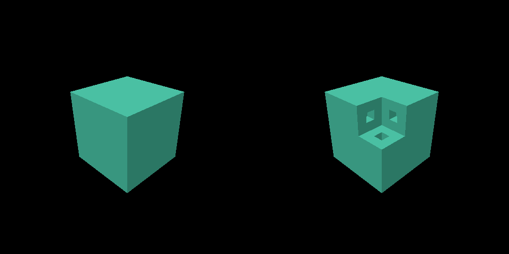

# Voxel rendering

The default native consumer draws the full Atelier from this repository’s voxel modules (original reference revision: `cdfd92d356229c5de5f4aaddd358f15ec3686dd4`). Production offscreen acceptance uses the same recorder. The earlier dense 8³ basic consumer remains available for regression exports and native `--cube`. Voxel policy lives in `src/`; the Vulkan library has no voxel dependency.

The historical milestone 4 readback below shows the intact basic cube on the left and the metric-demo carve on the right.



## Run and inspect exports

Initialize dependencies, then build and run from `vulkan` with Bend 2.0.39:

```sh
git -C .. submodule update --init --recursive deps/bend-vulkan
mkdir -p build
bend examples/voxel_offscreen.bend -o build/voxel-offscreen
./build/voxel-offscreen
```

The executable writes 512 by 512 PPM images to `build/voxel-intact.ppm`, `build/voxel-carved.ppm`, `build/voxel-reset.ppm`, and `build/voxel-empty.ppm`. The main carve uses upstream `MetricSphere.demo()`, centered at 65 cm on each axis with a 20 cm radius. It removes cells by their center positions. This is distinct from upstream's geometry-dump sphere and screen-click carve.

`build/voxel-upstream-intact.ppm` and `build/voxel-upstream-carved.ppm` preserve the old renderer's shaded image, ground, and shadows for visual inspection. Its unchanged `Tiles.image` algorithm runs directly on the CPU. The Vulkan executable has zero Bend bang dispatches and requires no CUDA compiler, runtime, or `.gpu` artifact. Vulkan still requires a driver.

## Ownership and updates

`Mesh.build` returns `Body & Result<Error,Mesh>`. The returned Body equals the original input on success and failure. Body remains the edit authority. Mesh owns canonical `Face` or `Rectangle` coverage, checked logical counts and U64 byte lengths, optional half-open owning-cell bounds, and packed vertex and index arrays. Edit and startup boundaries report build errors explicitly.

Dense bodies retain pinned extraction semantics. Their side must be a positive power of two at most 1,024, with a balanced side-cubed array. Cuboids have positive half-open extents and endpoints at most 2^20. Nonair boxes must be disjoint. Overlap errors identify both source indices. Material zero contributes no occupancy and does not erase other boxes. Exterior extraction subtracts outside-adjacent nonair coverage from each source face. Its six pure face partitions run independently and retain source and direction order.

The checked source and quad limit is 26,843,545. Each padded array has at most 2^30 words. Counts are checked before products, allocation, or narrowing. The Bend runtime still owns allocation failure behavior. The historical whole-mesh uploader checks both logical U64 byte lengths against the 16 MiB single-write limit before allocating or retiring buffers. Padding is never uploaded. Production uses the chunk upload path described below.

The basic offscreen regression uses `Renderer.replace_mesh`, which prepares replacement buffers and uploads the exact logical lengths of both arrays before retiring the previous geometry. An empty mesh owns no vertex or index buffers. Calls occur after the previous synchronous frame has observed its fence and reset its command buffer. `Renderer.frame` accepts a camera and diagnostic mode. It records, submits, waits, reads RGBA8 and D32 staging bytes, and resets the command and fence. It neither meshes nor uploads geometry.

The historical uploader uses host-visible mesh buffers. A HOST_WRITE to VERTEX_INPUT barrier publishes their vertex and index contents. Images use explicit color/depth attachment and transfer-source transitions. The staging transfer is made visible to the host after fence completion. Scope cleanup uses the existing Vulkan resource graph. Replacements atomically retire the complete set of obsolete dedicated buffers and allocations. The offscreen acceptance caller selects the returned Renderer before explicitly collecting retired resources. Collection releases them after command references disappear.

## Packed data

Every exposed unit face or rectangle has four vertices and six U32 indices. The triangle pattern is `0,1,2,2,3,0`, relative to the face's first vertex. Vertex stride is 40 bytes:

| Byte offset | Contents | Basic pipeline input format |
| --- | --- | --- |
| 0 | XYZ, three F32 words in voxel units | R32G32B32_SFLOAT |
| 12 | R, G, B, direction, one byte each | R8G8B8A8_UNORM |
| 16 | Complete material U32, little endian | R8G8B8A8_UNORM |
| 20 | Flat owning-cell anchor XYZ, three F32 words | Unused |
| 32 | Flat rectangle width and height, two F32 words | Unused |

Direction codes are `-X,+X,-Y,+Y,-Z,+Z` as `0,1,2,3,4,5`. The vertex shader recovers bytes with `round(attribute * 255)` and sends flat metadata to the fragment shader. The basic fragment shader outputs alpha one. The material diagnostic writes all four material bytes, including alpha. The direction diagnostic writes the direction byte to red and alpha one.

Basic colors come from upstream `material.Palette.surface` and `render.Face.light`, including the magenta fallback for unknown positive IDs. This byte encoding is display RGB in an RGBA8 UNORM target. No second sRGB conversion occurs. Mesh extraction and shader interpretation remain consumer responsibilities.

Binding offsets and base vertex are zero. Both triangles wind outward with cross-product area equal to width times height. The camera uses the upstream basis and pixel-center rays at 512 by 512. Camera-local XYZ maps to clip `(420/256*X, -420/256*Y, Z-near, Z)`. The positive-height viewport uses counterclockwise front faces and back-face culling. D32 depth is `1-near/Z`, with near 0.1 and an infinite far plane. This basic regression path uses a 64-byte column-major push matrix. Production reads camera and appearance data from the generated uniform block described below.

## Verification policy

`geometry.bend` independently enumerates cells and all six signed neighbors for small dense and cuboid fixtures. It compares oriented unit-face coverage, material, and multiplicity. It decodes packed positions, colors, direction, full material, flat anchor, extents, and indices. It checks corners, both outward triangles, the diagonal, exact index patterns, and coverage counts. Two halves of dense occupancy enumeration run independently. Full Atelier acceptance does not use this per-cell, per-face scan.

`tests/geometry_dump.bend` serializes each original Body before `Mesh.build`, then emits the returned Body and complete packed arrays through production imports. `tools/geometry_oracle.py` derives occupancy from the original alone and requires exact returned Body equality, including rejection cases. It checks every exterior unit face, material, multiplicity, internal-face absence, packed corner, metadata field, index, zero padding, capacity, bound, and logical size. Fixtures include touching materials, cavities, high material IDs, empty inputs, rejected overlaps, coordinate bounds, invalid dense shapes, and size overflow. `tools/geometry_clips.py` checks all 10,000 valid rectangle pairs over the 0 through 4 grid against independent set subtraction. `tools/check_geometry.py` also requires byte-identical native output with one and six CPU threads.

The pinned Atelier has 803,970 occupied cells, 423,136 exterior unit faces, and 10,304 quads. The actual 512-square viewport ray at 226,224 with `Camera.atelier()` removes 16 material-4 cells. The carved Body has 803,954 occupied cells, 423,162 faces, and 10,359 quads. Repeat changes zero cells. Reset restores the exact original Body and packed arrays.

`tests/geometry_device.bend` uploads the checked full-scene Mesh directly and compares actual Vulkan buffer readback with CPU arrays retained before upload. Intact vertex and index lengths are 1,648,640 and 247,296 bytes. Carved lengths are 1,657,440 and 248,616 bytes. Repeat and reset require exact readback equality. Camera-only frames preserve bytes and upload counts. Size rejection checks exercise both logical U64 lengths before resource changes. Empty geometry allocates no buffers. Replacements preserve row counts, and scope completion leaves zero rows.

A separate small cuboid fixture renders asymmetric rectangles through the basic diagnostic pipeline. Readback covers all six directions and the complete eight-material set. A camera inside the closed fixture requires clear pixels and depth, proving back-face culling. These checks establish full mesh coverage and input/culling behavior. The production identity acceptance below adds exact owning-cell diagnostics at internal and outer boundaries.

`fixtures.bend` separately checks the main intact and carved occupancy against an explicit cell-center distance formula. Repeated carving is idempotent. Reset restores the exact intact image. The run also checks an internal cavity, an empty body, and an adjacent eight-material strip.

`reference.bend` has an analytic ray/plane oracle independent of upstream hit selection. It also compares the selected material, direction, and normalized depth against upstream `Pixel.hit` on the same validated geometry and camera. The basic GPU frame is compared to the upstream basic palette, rather than the old renderer's lighting and ground.

The older basic cube reference comparison retains its milestone 4 edge policy. Projected face and rectangle polygons are clipped at the near plane. Their boundary segments define an inclusive Euclidean one-pixel band around pixel centers. Internal triangle diagonals never define exclusions. The report prints the excluded pixel count for every frame. Outside the band, occupancy and diagnostic bytes must match exactly, basic RGB may differ by at most one byte, and normalized depth has absolute tolerance `2e-5`.

Band pixels still have to represent valid geometry. Covered GPU pixels must match a face intersection, material/direction or basic color, and depth, with a `1e-4` cell-coordinate allowance for raster edges. They may not be behind the nearest oracle surface by more than the depth tolerance. A clear pixel is accepted only where no face has a strict interior intersection after a `1e-4` cell inset. Thus the band does not excuse interior cracks or arbitrary colors.

Diagnostic renders cover all six directions and material IDs `1,2,3,4,5,0x80000000,0x89abcdef,0xffffffff`. Both material and direction passes compare actual GPU readback. Visibility masks require every material and direction to have been observed. Camera-only frames compare mesh bytes before and after, check the upload counter, and render a moved camera. Eight carve/reset replacement cycles check the live-resource count after each replacement. Empty geometry has four fewer live rows. Scope completion requires zero rows.

## Production appearance and evidence

`appearance.bend` encodes the checked frame, linear palette, matrices, basis and exact sphere selection. `scene.bend` owns GPU geometry and stable appearance resources; `production.bend` owns offscreen attachments, readback and submission. Native presentation calls the same `Scene.record`. The generated ABI is 2,336 bytes with a 1,024-word encoder capacity, exactly 584 uploaded words and a 2,336-byte descriptor range. `tools/build_shaders.py` is the sole shader and schema builder; all GPU acceptance imports its canonical `-O` shader exports.

Production uses the flat anchor and extents at bytes 20 and 32 of every 40-byte vertex. Full U32 material and direction diagnostics return independently of analytic cell reconstruction. Raster-covered outer fringes clamp normalized expansion to the first or last owning cell. The division then multiplication inside a rectangle remains F32, including the width-41 counterexample. Four reproduced front-material controls retain actual primitive metadata and cells in `build/milestone-6-production/raster-trace.json`.

`production_oracle.py` requires shaded camera depth and coverage to equal the independent raw-material path at every pixel. Every covered pixel has exact original-Body material, exterior neighbor, direction and tangential cell checks; no pixel mask or lighting tolerance hides identity errors. Actual production-vertex metadata is checked against independent camera-ray and plane bounds. An injected one-cell tangential error must fail. The separate focused GPU fixture checks all 584 ABI words, 440 zero-tail pixels, 99 cases covering 786 diagnostic and tint pixels, six production-vertex rectangles with opposite-winding controls and two rendered-D32 sampling cases. Its fullscreen metadata adapter proves fragment identity math, not geometric coverage; the full mesh tests retain that responsibility.

The brush has fixed 20 cm radius. A bounded 125-cell enumeration uses pinned `MetricSphere.contains` and exact integer cells. Unknown occupied materials remain unlit magenta; selection replaces them with yellow. High material `0x80000102` retains all diagnostic bytes, including alpha. Invalid frame inputs fail explicitly.

Lighting evaluates pinned palette and daylight equations in linear RGB and applies display transfer once. Actual UNORM shader transfer and SRGB attachment transfer agree within one display byte. Independent equations check stable production RGB against the actual nine-tap shadow-depth visibility. The gradient uses actual pixel centers at scaled extents. Ground and grid never write voxel depth and ground is not pickable.

Production renders and samples fixed 512-square D32 shadow depth every frame. The pinned Atelier also uses effective 512-square depth through its `Resolution` wrapper; `Shadow.width()` returning 128 is only the base definition. `tests/reference_resolution.bend` executes that effective-resolution probe. Explicit 128-square reference records are a separate experiment. Original cached512, original direct512 and actual-GPU direct512 visibility remain separate measurements.

`shadow_causality.py` reconstructs casters from original Body boxes and original Body and Surface receiver records, independently of production mesh triangles. It checks 1,746 intact and 1,747 carved taps, with 1,653 intact and 1,661 carved stable caster witnesses, plus 65 stable clear witnesses in each state. Every selected actual depth and changed comparison needs a source-caster certificate. The measured device precision is eight subpixel bits, giving a 1/256-pixel quantum. Per-face projected-edge bounds and depth slopes derive each numerical allowance; the current derived D32 bounds range approximately from `1.6085e-6` to `7.7377e-6`. This is not a blanket tile-edge or image exclusion. The separate `3e-7` PCF threshold only classifies ambiguous comparisons.

Original cache versus direct512 counts differ at 15 intact and 10 carved receivers. Direct reference versus actual GPU512 differs at 13 receivers in each state. All 17 intact and 16 carved changed taps have causal witnesses: 13 intact and 12 carved same-plane bounded interpolation records and four silhouette caster-substitution records per state. The substitutions require stable nearest-grid omission of the original caster and coverage by the next original caster. Zero selected depths or changed taps remain unexplained. This checks a named subset of shadow texels; it does not claim exact driver edge ownership or every GPU instruction. Missing-pass, zero-depth, one-texel shift, stable-depth spike and disputed-edge spike controls all fail the same gate.

Rings use three 32-segment circles and 576 static indices, near clipping, an inclusive 0.75-pixel stroke and reciprocal eye depth. Tests form separate unions of definitely visible and possibly visible strokes from individual segments. Removing every ring must fail, and the actual intact Atelier has 13 definite observable pixels outside selected-yellow pixels and depth-contact ambiguity. The foreground fixture has 936 hidden stroke pixels with no leak. Other fixtures exercise portrait and landscape extents, near clipping, degenerate projected segments and 86 pixels distinguishing reciprocal from linear depth. The ring edge diagnostic is 0.03 pixels and depth-contact diagnostic is `6e-8`; these do not exclude state or identity checks. Ground and rings leave the empty voxel depth clear.

Direct `check_production.py` invocations require the original reference records from `check_reference_lighting.py`. Run the focused and complete checks in this order:

```sh
python3 tools/check_appearance_math.py
python3 tools/check_reference_lighting.py
python3 tools/check_appearance_gpu.py --sanitize
python3 tools/check_production.py --sanitize
python3 tools/shadow_causality.py
python3 tools/check_production.py --shadow-only
python3 tools/check_acquisition.py --sanitize --isolated-display
python3 tools/check_atelier_window.py --sanitize --isolated-display
env -u DISPLAY python3 tools/verify.py --sanitize --presentation --isolated-display
```

`shadow_causality.py` defaults to the coherent snapshot produced by `check_production.py`; `--shadow-only` snapshots successful existing captures and checks all five corrupt-depth controls without rendering again. Capture manifests retain hashes, original receiver provenance and actual `vulkaninfo` precision. Full reports, raw attachments, actual offscreen PNGs and command statuses remain under `build/milestone-6-production/`. The full-gate log is `build/milestone-6-appearance-verification.log`; its separately executed final pure-port gate is `build/milestone-6-shadow-causality-verification.log`. Old logs/reference captures remain intact. Headless binaries retain no X11/xcb or CUDA dispatch dependency.

## Proof and support limits

The normal Bend checker accepts the claims in `LAWS.bend` and `PROOF.bend` for pure material-word preservation, byte packing examples, direction codes, face counts, symbolic quad-index patterns, both outward triangle normals, and all quad-index bounds across the 3,072-face fixture limit. The checked count recurrence is universal over face, tail, and starting count, including its explicit limit failure branch. Additional laws preserve rectangle material and direction, clipped-list materials, asymmetric winding, checked size limits, and U64 byte limbs. General clipping coverage and disjointness are not universally proven. They use exhaustive small-grid subtraction and exact original-Body fixture checks.

`bend PROOF.bend` remains the required normal-checker gate. The independent kernel has not validated the combined proof file. The retained 3,072-quad index-bound law has a checker/kernel mismatch in the reviewed scratch artifact and its unchanged corresponding baseline. No assertion or fixture capacity is reduced to avoid it. These laws do not prove floating-point camera arithmetic, native code, or shaders. Those use executed geometry and GPU checks.

Run the complete gate with:

```sh
python3 tools/verify.py --sanitize
```

The verifier checks the dependency pin, generation freshness, normal proofs, all previous consumers, original-reference and actual production appearance, Khronos and synchronization validation when installed, and relevant real-device ASan/UBSan execution. `--presentation` additionally requires default Atelier and explicit cube regression runs on actual native windows. A missing device fails; unavailable validation is reported separately. Logs and actual compiled C remain in `build/`. Driver-global leak detection is disabled; explicit wrapper row/allocation checks cover cleanup.

The shadow-causality evidence runner currently requires one enumerated capture device so saved subpixel precision is unambiguous. Its fixed-light original-cuboid model covers the pinned Atelier fixtures.

The historical mesh consumer retains its whole-mesh reference path and strict count/packing checks. Production rendering uses sparse chunk generations and independent frame slots. Each native write still observes the 16 MiB limit; reusable staging splits larger valid logical streams into checked writes. Coordinate and overlap limits above remain enforced. Native presentation retains the Linux/X11 maintenance1 boundary documented in the [presentation contract](presentation.md).

## Sparse chunks and frame generations

The optimized renderer derives a sparse `ChunkSet` from the authoritative `Body`.
Dense chunks cover at most 32 cells per axis and read an immutable one-cell halo.
Cuboid chunks group exact source tuples in adaptive analytic regions. A valid
cuboid with a 2^20-cell edge remains analytic. Cut invalidation includes adjacent
exterior owners and source domains changed by cuboid splitting.

Canonical primitives retain the original face anchors, extents, materials and
source order. Draw runs select contiguous index ranges in immutable chunk
buffers. A separate greedy rectangle stream feeds the production shadow pass.
`tools/check_chunks.py` checks exact canonical order, signed rectangle coverage,
dirty neighbors, unchanged generations and byte-identical output with one and
six CPU threads. It compares returned Body state with an independent original
input or pinned cut, and builds the reference mesh from that independent state.
A matching material-mutated Body and mesh fail its negative control. The original
geometry checker retains its strict face/count and packing checks.

The dense cube fixture reduces 384 canonical quads to six shadow rectangles.
The analytic merge fixture reduces ten to six. Atelier has 49 chunks, 771
canonical draw runs, 10,304 canonical quads and 9,043 shadow rectangles. These
counts establish real greedy reductions, without establishing a timing benefit.

`generation.bend` prepares changed chunks through reusable staging and GPU buffer
copies. Every prepare result returns the CPU chunk arrays and staging owner.
Allocation or upload failure disposes only new buffers. Publication atomically
retires every obsolete color and shadow allocation in one validated set. Unchanged
residents and reusable frame staging are excluded. Recorded command references
retain retired allocations until successful reset or command-pool destruction. Abort requires
removing any recorded references first. The shared `Scene.record` publication
barrier covers host and transfer writes before vertex and index reads.

The offscreen production recorder uses this chunk path. Its unchanged appearance
and original-Body shadow-causality gates include five corrupt-depth negative
controls. `tools/check_generations.py` exercises actual device bytes, no-op
reuse, empty-after-edit, reset, injected failures and resource cleanup. The
offscreen installer reuses its caller-owned command buffer and fence. It checks
them before preparing replacements. On a handled recording or submission error,
it attempts command reset, retires candidate allocations and releases staging.
Pending or uncertain recordings keep their sealed resources until recovery and
successful reset. `tools/check_installation.py` retries controlled begin and
mid-copy failures while checking the original device bytes and resource rows.


Native frames use the same chunk preparation and `Scene.record` as offscreen
production. Body and the derived CPU chunk set advance before another queued
edit. Acquisition completion selects the latest coherent geometry, camera,
brush and encoded 2,336-byte appearance input. Each slot owns its uniform,
descriptors, shadow image, depth image, image framebuffers, command resources,
staging and optional diagnostic queries. Immutable programs and chunk buffers
are shared. After submission, a small receipt retains the exact acquisition,
revision, submission sequence, CPU start time and query view. The recorded command
retains geometry. Slot resources retain frozen appearance until observation of
the matching presentation-resource fence and successful command reset. That fence
may signal before the full present operation completes. Physical scanout is not
measured.

Greedy shadow rasterization does not imply bit-identical shaded output. The
archived milestone 6 comparison contains 195 RGBA captures. Of these, 171 are
exact and 24 shaded captures differ by at most four channel units. Intact,
carved and reset each differ at five pixels; portrait differs at 92 pixels.
Canonical metadata and identity outputs are exact. The unchanged production
appearance policy and actual D32 shadow-causality gate remain required. Native
measurement pairs have an additional exact static-image gate; failing that gate
makes the pair ineligible for comparative timing, even when appearance acceptance
passes.

The five-pair old/new native run completed all 20 processes with exit zero and
all 160 cut/reset actions. Every one of its 90 static capture comparisons differs
at four RGB pixels, with a maximum channel delta of four. Geometry and view
fields match. These mismatches exclude all five flight pairs and all five edit
pairs. They establish no implementation speedup or regression. Pixel counts do
not establish the cause of the differences. The [milestone 7 evidence](../../deps/bend-vulkan/.audit/m7-results.md)
retains the comparison, static-image rows and build provenance. Raw local captures
remain under the paths recorded in those reports.

## Production voxel frame contract

The voxel consumer retains the earlier 64-byte push shaders for basic cube regressions. Production uses a generated 2,336-byte std140 uniform block. `tools/build_shaders.py` owns one field table for GLSL declarations, Bend offsets, literal ABI diagnostics and freshness checks. It embeds canonical optimized SPIR-V in deterministic 128-word list chunks without changing shader words.

`src/appearance.bend` validates and encodes camera and light matrices, viewport, pinned linear palette, fixed brush, flags and up to 125 exact selected integer cells. Its array capacity is 1,024 words; only the 584 payload words are uploaded. The uniform buffer and descriptor range are exactly 2,336 bytes. Invalid frame inputs return failure. Mesh vertices remain 40 bytes, including full material bits, flat owning-cell anchor and rectangle extents.

`src/scene.bend` owns the uniform, descriptor schemas, pool and sets, normalized nearest sampler, fixed 512-square sampled D32 shadow target, layouts for the frame and main pass, static 576 ring indices and GPU geometry. Main-format pipelines belong to the output target and unwind partial creation. Stable resources survive target resize.

The shared recorder clears and renders shadow depth each frame, orders early and late depth writes before fragment sampling, draws gradient, ground and grid without voxel-depth writes, draws shaded geometry and draws rings with depth tests but no depth writes. It rebinds descriptor sets after every pipeline bind. A memory dependency orders previous fragment sampling, depth attachment access and transfer reads before discard-to-shadow-attachment reuse; the discard image barrier itself retains zero source access. Offscreen and native owners retain attachment transitions, submission, readback or presentation and completion and command reset before host writes.

The consumer uses public effects. The wrapper does not infer layouts, add a render graph or supply a voxel-specific native binding. See the [voxel appearance policy](voxel.md#production-appearance-and-evidence) and [presentation lifecycle](presentation.md).
